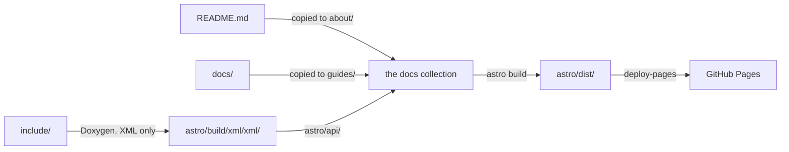

import { Aside, FileTree, LinkCard, Steps } from '@astrojs/starlight/components';

This site is generated from the repository itself. The guide comes from
`docs/`, the *About* page from `README.md`, and the API reference from the
Doxygen comments in the headers. A single GitHub Actions workflow builds all
three with [Astro](https://astro.build) and
[Starlight](https://starlight.astro.build), and publishes the result to GitHub
Pages at [darkbriks.github.io/TLOR](https://darkbriks.github.io/TLOR/).

<Aside type="note" title="Where the template comes from">
The Astro project in `astro/` is adapted from a more complete documentation
toolchain originally written for another project,
[liara-engine/docs-shared](https://github.com/liara-engine/docs-shared). That
one builds a site per module and per version, ships as a container image, and
publishes to a shared host with a site-wide search index and pull request
previews.

TLOR has one site and one version, so all of that is gone. What is left is the
Starlight configuration, the components and styles, and the loader that turns
Doxygen XML into Starlight pages.
</Aside>

## 1. The big picture



Hand-written pages and generated API pages end up in the **same** Starlight
content collection. That is why the API reference is a section of the site
rather than a separate one: same layout, same sidebar, same theme, same search.

## 2. The workflow

`.github/workflows/deploy.yml` runs on every push to the branches listed under
`on.push`, and can be started by hand from the *Actions* tab
(`workflow_dispatch`). It has two jobs:

<Steps>

1. **Assemble.** `README.md` is copied to `astro/src/content/docs/about/`, and
   the content of `docs/` to `astro/src/content/docs/guides/`. Those
   directories only exist in CI: edit the originals, never the copies. The
   "Edit page" link and the "Last updated" date of each page still refer to
   the original, which is why the checkout fetches the full history.

2. **Extract the API surface.** Doxygen runs on the repository's `Doxyfile`,
   with every setting that describes *output* restated afterwards. `INPUT` is
   set to `include/`, only XML is generated, and it lands in
   `astro/build/xml/xml/`. `INTERNAL_DOCS = YES` keeps `@internal` markers in
   the XML so the loader can act on them, and `SORT_MEMBER_DOCS = NO` keeps
   members in declaration order.

3. **Build.** [`withastro/action`](https://github.com/withastro/action)
   installs the dependencies of `astro/`, runs the Astro build, and uploads
   `astro/dist/` as a Pages artifact. Starlight builds the
   [Pagefind](https://pagefind.app) search index at the same time.

4. **Deploy.** The `deploy` job publishes that artifact with
   `actions/deploy-pages`.

</Steps>

<Aside type="caution" title="No headers, no API">
As long as the repository has no `include/` directory, Doxygen only warns and
the API reference is an empty overview page; the build still succeeds. When
there is no XML at all, as in a local build that skipped Doxygen, the loader
also only warns, unless `LIARA_DOCS_API=true` is set.
</Aside>

## 3. The Astro project

<FileTree>
- astro/
  - astro.config.mjs site URL, base path, sidebar, component overrides
  - sections.mjs the sections, their sidebar labels, and where each is copied from
  - src/
    - content.config.ts the `docs` collection: Markdown pages plus generated API pages
    - routeData.ts points "Edit page" links and dates back at the originals
    - pages/
      - index.astro the landing page and its cards
      - 404.astro the not-found page
    - layouts/HubLayout.astro the shell of the 404 page
    - content/
      - docs/ **filled by the workflow**, ignored by git
      - i18n/en.json overrides for Starlight's UI strings (none yet)
  - api/ Doxygen XML to Starlight pages
    - loader.mjs adds the generated pages to the collection
    - doxygen.mjs reads the XML and writes HTML directly
    - filter.mjs what is left out of the reference
    - pages.mjs the page model
    - render.mjs the markup of a page
    - groups.mjs how the reference divides into sidebar sections
    - highlight.mjs Shiki highlighting for declarations
  - components/ Starlight overrides: breadcrumbs, header, reading preferences
  - styles/ design tokens, theme, API and landing page styles, fonts
  - public/ favicon
</FileTree>

### 3.1 URLs

| URL | Content |
| --- | --- |
| `/TLOR/` | The landing page |
| `/TLOR/guides/…` | Pages from `docs/` |
| `/TLOR/about/readme/` | `README.md` |
| `/TLOR/api/` | The API overview |
| `/TLOR/api/<group>/…` | Generated pages, by kind: `headers`, `namespaces`, `classes`, `concepts` |

The base path is set once, as `base` in `astro.config.mjs`. Astro prefixes
every link it generates with it, and `content.config.ts` hands it to the API
loader so generated cross-references carry it too. Links you write by hand do
not get it for free; see
[Writing pages](../writing-pages/#3-links).

### 3.2 From headers to API pages

The loader reads Doxygen's **XML**, not its HTML, and produces HTML directly,
with no Markdown or MDX in between. Doc comments are full of `<`, `>` and `{`,
which are all syntax in MDX; skipping that step removes a whole class of build
failures. The pages are then stored in the collection already rendered.

A few properties follow from how it is written:

- **Stable URLs.** Slugs are derived from symbol names, not from Doxygen's
  internal identifiers, which change whenever a signature does.
- **No dead links.** Cross-references are resolved once every page is known. A
  reference to something that has no page is rendered as plain code.
- **One page per header.** This is the `file` layout, the default. A `symbol`
  layout, with one page per symbol, exists for large C++ surfaces; switch to it
  by passing `split: 'symbol'` to `doxygenLoader()` in `content.config.ts`.

## 4. Building locally

The workflow is the reference, but the same steps work on a workstation with
Node and, for the API reference, Doxygen. From the repository root:

```bash frame="terminal"
mkdir -p astro/src/content/docs/about astro/src/content/docs/guides
cp README.md astro/src/content/docs/about/
cp -a docs/. astro/src/content/docs/guides/
cd astro && npm ci && npm run dev
```

The development server reloads when the *copies* change, not the originals:
run the `cp` lines again after editing a page. Search only exists in a
production build, so use `npm run build && npm run preview` to try it.

To include the API reference, generate the XML first, from the repository
root. Doxygen does not create its output directory itself, and the empty
`echo` matters: `Doxyfile` may does not end with a newline.

```bash frame="terminal"
mkdir -p astro/build/xml
{ cat Doxyfile
  echo
  echo 'INPUT = include'
  echo 'GENERATE_XML = YES'
  echo 'GENERATE_HTML = NO'
  echo 'GENERATE_LATEX = NO'
  echo 'INTERNAL_DOCS = YES'
  echo 'SORT_MEMBER_DOCS = NO'
  echo 'OUTPUT_DIRECTORY = astro/build/xml'
  echo 'XML_OUTPUT = xml'
} | doxygen -
```

## 5. Where to change what

| To change… | Edit… |
| --- | --- |
| The guide | `docs/` |
| The *About* page | `README.md` |
| The API reference | The doc comments in `include/` |
| What Doxygen reads | `Doxyfile` — its output settings are overridden |
| Sidebar, title, base path, social links | `astro/astro.config.mjs` |
| The landing page | `astro/src/pages/index.astro` |
| Colours, typography, spacing | `astro/styles/` |
| The markup of API pages | `astro/api/` |
| Build and deployment steps | `.github/workflows/deploy.yml` |

<LinkCard
	title="Writing pages"
	href="../writing-pages/"
	description="Where pages go, the front matter they need, and how to document headers."
/>
