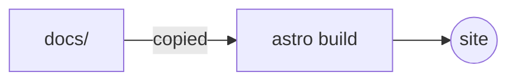

import { Aside, Badge, Card, CardGrid, FileTree, LinkCard, Steps, TabItem, Tabs } from '@astrojs/starlight/components';

Writing for this site takes no knowledge of Astro. A page is a Markdown file
in `docs/`, and the API reference is written as comments in the headers. This
page covers both. The
[Starlight documentation](https://starlight.astro.build/guides/authoring-content/)
has the complete reference.

## 1. Where pages go

<FileTree>
- README.md published under *About*
- docs/ one file per page, published under *Guide*
  - index.mdx the front page of the section
  - getting-started.md
  - Architecture/ a folder becomes a sidebar group, labelled with its name
    - overview.md
    - data-model.md
</FileTree>

The URL follows the path, in lower case: `docs/Architecture/overview.md` is
published at `/TLOR/guides/architecture/overview/`. The sidebar is generated
from the tree, so there is no index file to keep up to date.

## 2. Front matter

Every page starts with a YAML block:

```yaml title="docs/getting-started.md"
---
title: Getting started
description: Build the project and run it on the sample data.
sidebar:
  order: 1
  label: Start here
---
```

| Key | Role |
| --- | --- |
| `title` | <Badge text="required" variant="danger" /> The page heading, and its sidebar entry |
| `description` | The page's meta description, used in link previews; *About* pages also show it on the landing page |
| `sidebar.order` | Position within its group; lower comes first |
| `sidebar.label` | A sidebar entry shorter than the title |

<Aside type="caution" title="A page without a title breaks the build">
Nothing adds a front matter block for you: a file without a `title` fails the
whole build, not just its own page. `README.md` needs one too. GitHub shows it
as a small table at the top of the file.
</Aside>

<Aside type="tip" title=".md or .mdx">
Plain `.md` covers Markdown, asides, code blocks and diagrams, which is enough
for most pages. The components in §4.2 need `.mdx`. Renaming a page from
`.md` to `.mdx` does not change its URL.
</Aside>

## 3. Links

Pages in `docs/` are published under `/TLOR/guides/`, so a link from one page
to another is best written **relative**, ending with a slash:

```md
See [the pipeline](../pipeline/) for how this page gets built.
```

An absolute link must include the base path: `/TLOR/about/readme/`, not
`/about/readme/`. To link to a heading, append its text in lower case, with
punctuation dropped and spaces turned into dashes:
`../pipeline/#4-building-locally`.

## 4. What you can write

Everything below is rendered by this page, so it doubles as a test of the
site.

### 4.1 Asides

Four kinds, in `.md` and `.mdx` alike:

```md
:::note
Useful to know.
:::

:::caution[Careful]
An aside can carry its own title in brackets.
:::
```

:::note
Useful to know.
:::

:::caution[Careful]
An aside can carry its own title in brackets.
:::

The other two are `:::tip` and `:::danger`.

### 4.2 Components

In an `.mdx` page, import them from `@astrojs/starlight/components`:

```jsx
import { Badge, CardGrid, Card, Steps, Tabs, TabItem } from '@astrojs/starlight/components';
```

<Tabs>
<TabItem label="Steps">

<Steps>

1. Write the page.

2. Build the site locally.

3. Push.

</Steps>

</TabItem>
<TabItem label="Cards">

<CardGrid>
	<Card title="Guide" icon="open-book">
		Hand-written pages, in `docs/`.
	</Card>
	<Card title="API reference" icon="puzzle">
		Generated from the headers.
	</Card>
</CardGrid>

</TabItem>
<TabItem label="Badges">

<Badge text="stable" variant="success" /> <Badge text="experimental" variant="caution" /> <Badge text="removed" variant="danger" />

</TabItem>
</Tabs>

[The component reference](https://starlight.astro.build/components/using-components/)
lists the rest: file trees, link cards, icons, and more.

### 4.3 Code

Code blocks can carry a title, highlighted lines, and inserted or deleted
lines:

````md
```cpp title="src/main.cpp" {3} ins={4}
```
````

```cpp title="src/main.cpp" {3} ins={4}
#include <iostream>

int main() {
    std::cout << "Hello, TLOR\n";
}
```

`frame="terminal"` renders a block as a terminal window instead:

```bash frame="terminal"
cmake --preset linux-debug && cmake --build --preset linux-debug
```

Always tag a block with its language: every grammar Shiki supports is
available.

### 4.4 Diagrams

A `mermaid` code block becomes a diagram that follows the light and dark
themes:



### 4.5 The rest of Markdown

Tables, footnotes[^1], task lists, `inline code`, **bold**, *italic*,
~~strikethrough~~, and inline HTML such as <kbd>Ctrl</kbd> + <kbd>K</kbd> work
as you would expect.

[^1]: Like this one.

## 5. Documenting headers

The API reference is generated from the headers under `include/`. Comments use
the Javadoc style:

```cpp title="include/tlor/example.hpp"
/**
 * @file example.hpp
 * @brief What this header is for, in one sentence.
 */
#pragma once

namespace tlor {

/**
 * @brief Adds two durations.
 *
 * @param a First duration, in seconds.
 * @param b Second duration, in seconds.
 * @return The sum of @p a and @p b.
 *
 * @pre Both durations are non-negative.
 */
double add(double a, double b);

} // namespace tlor
```

Where each part ends up:

- `@brief` is the lead of the symbol, set apart from the rest of the text.
- `@param`, `@tparam`, `@return`, `@retval` and `@exception` become tables:
  **Parameters**, **Template parameters**, **Returns**, **Throws**. They are
  always in the same place, whatever order you write them in.
- `@note`, `@warning`, `@pre`, `@post`, `@since`, `@see`, `@deprecated`,
  `@todo`, `@par` and the rest stay where you wrote them, as coloured labelled
  blocks. The `Doxyfile` also defines a `@threadsafety … @endthreadsafety`
  block.
- `@ref` and type names that match a documented symbol become links.

Pages are filed by kind, and each kind is a sidebar section: **Headers**,
**Namespaces**, **Classes and structs**, **Concepts**. Sections with nothing
in them are hidden.

### 5.1 Keeping things out

`EXTRACT_ALL` is on, so Doxygen reports everything. Some of it is removed
automatically: `*_export.h` headers, anything under `detail/`, `internal/` or
`impl/`, the `std` namespace and implementation namespaces such as `detail`,
and anonymous compounds.

For anything else, use `@internal`. In the `@file` block it keeps the whole
header out; on a symbol, just that symbol.

<Aside type="note" title="Undocumented is not hidden">
A symbol without a comment still appears, by name and declaration only, in a
collapsed **Also declared here** list at the bottom of its page. A header with
nothing documented and no `@file` description gets no page at all.
</Aside>

## 6. Before you push

The workflow does not build previews, so the only way to see a page before it
goes live is a local build: see
[Building locally](../pipeline/#4-building-locally). Check that the build
passes, that the page sits where you expect in the sidebar, and that its links
work.

<LinkCard
	title="The documentation pipeline"
	href="../pipeline/"
	description="What happens to these files once they are pushed."
/>
