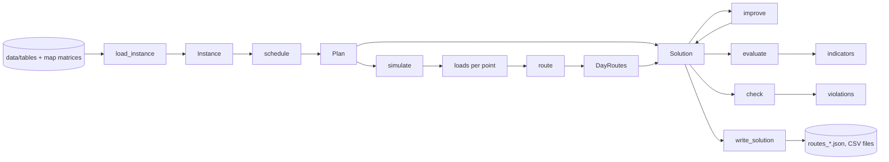

import { CardGrid, LinkCard } from '@astrojs/starlight/components';

The TLOR library solves the collection problem one step at a time: it decides
**which day** each point is collected (schedule), **how** the trucks drive
each day (route), and then tries to **improve** both. It also simulates the
containers, measures a solution with indicators, checks it against every
constraint, and times each step. Cleaning the data (step 1 of the team plan)
is not part of it: the library reads the cleaned tables.

The same library serves everyone. It is written in C++, exposes a C
interface, and ships a Python package on top of that interface, so a method
written in Python can be chained with one written in C++, and both are judged
by the same checker and the same indicators.

## 1. The pieces



- **Model.** An *instance* holds the network (distances, durations, service
  times), the containers (capacity, active flag) and the predicted demand. A
  *fleet* holds the trucks and the days each one works. A *state* holds the
  level of every container at the start of a day. See
  [Concepts](../concepts/).
- **Steps.** `schedule`, `route` and `improve` each take a **method name**
  and its parameters. `run_rolling` chains them over a rolling horizon, day by
  day or week by week. See [Steps and the rolling driver](../steps/).
- **Methods.** Each step has a registry of methods. Four methods ship with
  the library (`threshold`, `nearest_neighbour`, `greedy`, `shift_day`), and
  anyone can add more, in C++ or in Python, without touching the steps. See
  [Built-in methods](../methods/).
- **Judges.** `evaluate` computes 14 indicators per day and in total; the
  objective is a weighted sum of them, with weights you choose. `check`
  lists every broken constraint. Neither knows which method produced the
  solution.
- **Report.** Pass a report to any call and the library records the time of
  each step and phase in a JSON file. See [Time report](../report/).
- **Files.** The library loads the project data and writes routes in the
  format the map tools draw. See [Files and the TLOR program](../files-and-cli/).

## 2. Which way to use it

| You want to… | Use | Page |
| --- | --- | --- |
| Run the whole chain on the data and look at the result | the `TLOR` program | [Files and the TLOR program](../files-and-cli/) |
| Experiment, compare methods, write a method quickly | the Python package `tlor` | [Python package](../python/) |
| Write a fast method that everybody can use | a C++ method inside the library | [C++](../cpp/) |
| Call the library from another language | the C interface `tlor.h` | [C interface](../c-api/) |

Methods are found by name everywhere: a method added in C++ is available from
Python, from C and from the command line as soon as the library is rebuilt;
a method registered from Python is available to every call made in that
Python process, including `run_rolling` and `improve`.

## 3. Quick start in Python

After [building the library and setting up Python](../../bootstrap/build-and-run/#5-python-package),
from the root of the repository:

```python title="quick_start.py"
import tlor

inst = tlor.Instance.load("data/tables", "Maps/offline map/data")
fleet = tlor.Fleet([8000] * 6, [8 * 3600] * 6, inst.day_count)
result = tlor.run_rolling(inst, fleet, first=0, last=inst.day_count - 1, horizon=7, step=1,
                          schedule="threshold", route="nearest_neighbour")
print(result.evaluation.total["distance_m"], "m,", len(result.violations), "violations")
tlor.write_solution("local/runs/quick", inst, result.solution)
```

```bash frame="terminal"
PYTHONPATH=python .venv/bin/python quick_start.py
```

`local/runs/quick/` then holds one `routes_<date>.json` per day, ready for the
[map tools](../../bootstrap/map-tools/), plus `collection_schedule.csv` and
`route_statistics.csv`.

## 4. Going further

<CardGrid>
	<LinkCard title="Concepts" href="../concepts/" description="Days, states, the fill convention, plans, routes, indicators and the objective." />
	<LinkCard title="Steps and the rolling driver" href="../steps/" description="What each step takes and returns, and how run_rolling chains them." />
	<LinkCard title="Built-in methods" href="../methods/" description="threshold, nearest_neighbour and shift_day: rules and parameters." />
	<LinkCard title="Python package" href="../python/" description="Every class and function, and how to write a method in Python." />
	<LinkCard title="C++" href="../cpp/" description="Use the library from C++ and add a built-in method." />
	<LinkCard title="C interface" href="../c-api/" description="Handles, status codes, lifetimes and external methods." />
	<LinkCard title="Files and the TLOR program" href="../files-and-cli/" description="Input and output files, and every option of the command line." />
	<LinkCard title="Time report" href="../report/" description="Measure where the time goes and compare runs." />
</CardGrid>

The [API reference](/TLOR/api/) lists every C and C++ declaration with its
documentation comment.
