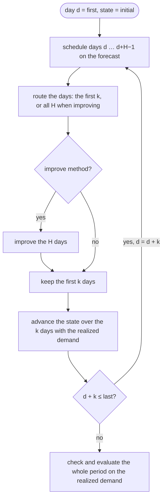

The library has no single "solve" function. Each step is a function of its
own, so a team member can work on one step, call it alone, and plug it back
into the chain. The names below are the Python ones; C++ and C use the same
names and arguments (see [C++](../cpp/) and [C interface](../c-api/)).

## 1. The steps

| Function | Takes | Returns |
| --- | --- | --- |
| `schedule` | instance, fleet, start state, start day, horizon, method, params, weights | a plan of `horizon` days from the start day |
| `route` | instance, fleet, day, points of that day, load of each point in kg, method, params, weights | the routes of that day |
| `improve` | instance, fleet, start state, solution, route method and its params, method, params, weights | a new solution over the same days |
| `simulate` | instance, start state, start day, number of days, plan, demand | the state after those days, and the level of every container each day |
| `evaluate` | instance, fleet, start state, solution, demand, evaluation params | indicators per day and in total |
| `objective` | indicators, weights | a number, lower is better |
| `check` | instance, fleet, start state, solution, demand | the list of violations |
| `run_rolling` | instance, fleet, initial state, first and last day, horizon, step, a method and its params for each step, weights | a solution over the whole period, its indicators and violations |

The *start state* is the state of the containers at the start of the first
day concerned. Where a demand is optional, leaving it out means the
predicted demand of the instance.

### 1.1 `schedule`

Decides which points are collected on each day of `[start, start + horizon)`.
A horizon that runs past the last day of the data is cut at the last day. The
start state must belong to the start day (no collection recorded on or after
it). The schedule method sees the predicted demand only.

### 1.2 `route`

Builds the routes of one day for the given points. `route` knows nothing
about containers: you give it the mass to collect at each point. The usual
way to get those masses is `simulate` on the plan (see §2). Each point must
be an active point, given once, with a finite, non-negative load.

The routes always come back, even when the trucks of the day cannot carry
everything or when no truck is available that day: `check` then reports
`capacity`, `work_time` or `truck_unavailable`.

### 1.3 `improve`

Starts from a complete solution (planned and routed) and returns a better one
over the same days. It receives the name of the route method to use whenever
it changes a day, so it works with any routing method, Python ones included.
It must keep the plan's first day and horizon.

### 1.4 `simulate`

Applies the [fill convention](../concepts/#3-containers-state-and-fill-convention)
day by day. Its second result has one row per simulated day and one column
per node: the level of each container **before** that day's collection, which
is exactly the mass a truck collects at a planned point.

### 1.5 `evaluate`, `objective`, `check`

`evaluate` and `check` take a demand: pass the **realized** demand to judge
a plan made on the forecast, or nothing to judge it on the forecast itself.
`evaluate` accepts one evaluation parameter, `low_fill_threshold` (default
`0.5`). Both are described in [Concepts](../concepts/#7-indicators-and-objective).

## 2. Chaining the steps by hand

The chain that `run_rolling` automates, written out for one week from day 0:

```python title="by_hand.py"
import tlor

inst = tlor.Instance.load("data/tables", "Maps/offline map/data")
fleet = tlor.Fleet([8000] * 6, [8 * 3600] * 6, inst.day_count)
state = tlor.State.initial(inst)

plan = tlor.schedule(inst, fleet, state, 0, 7, "threshold", params={"threshold": 0.9})
_, levels = tlor.simulate(inst, state, 0, 7, plan)

solution = tlor.Solution(plan)
for day in range(7):
    points = plan.points(day)
    if len(points):
        loads = levels[day, points]
        solution.set_routes(tlor.route(inst, fleet, day, points, loads, "nearest_neighbour"))

weights = {"distance_m": 1.0, "overflow_point_days": 1e6}
better = tlor.improve(inst, fleet, state, solution, "nearest_neighbour", "shift_day",
                      params={"seed": 7}, weights=weights)

evaluation = tlor.evaluate(inst, fleet, state, better)
print(evaluation.objective(weights), evaluation.total["routes"])
for violation in tlor.check(inst, fleet, state, better):
    print(violation.kind, violation.day, violation.message)
```

`levels[day, points]` picks, for that day, the level of each planned point:
the mass its truck will collect.

## 3. The rolling driver

`run_rolling` plans the period `[first, last]` the way it would be done in
practice: the forecast is only trusted a few days ahead, and the plan is
redone as days go by.



- **`horizon` (H)** is how many days each window plans; **`step` (k)** is how
  many of them are kept before planning again. Day by day is `step=1`, week
  by week is `horizon=7, step=7`. `step` must be at least 1 and at most
  `horizon`. A window that runs past `last` is cut at `last`.
- Only the kept days are routed when no improve method is given, since the
  others are thrown away.
- The state moves forward with the **realized demand** when you pass one
  (`realized_demand_kg`, a day × node array), otherwise with the forecast. So
  a plan built on the forecast is judged, and continued, on what really
  happened. This never raises an error: the gaps show up as `overflow` or
  `capacity` violations.
- At the end, the whole solution is checked and evaluated from the initial
  state, with the realized demand.
- With `check_each_step=True`, each window's kept days are also checked as
  soon as they are decided, and the counts appear in the
  [time report](../report/) as counters named `violations:<kind>`.

The result holds the `solution` over `[first, last]`, its `evaluation`, the
list of `violations`, and the `end_state` after `last`.

```python
result = tlor.run_rolling(
    inst, fleet, first=0, last=inst.day_count - 1, horizon=7, step=1,
    schedule=("threshold", {"threshold": 0.85}),
    route="nearest_neighbour",
    improve=("shift_day", {"max_iterations": 200, "seed": 1}),
    weights={"distance_m": 1.0, "overflow_point_days": 1e6},
)
```

A method is given either by name, or as a `(name, params)` pair.

### 3.1 Starting later than day 0

`first` can be any day of the data, but the containers then start from the
`state` you pass, by default empty and never collected. Starting on day 20
with the default state ignores the waste of days 0 to 19 and gives optimistic
results. To start later on purpose, build the state of that day, for
instance with `simulate` over the earlier days.

## 4. Reproducibility

The same inputs, parameters and seed give the same result on every platform.
Methods that use randomness take a `seed` parameter and draw numbers from the
library's own generator (`tlor::Random` in C++), not from the standard
distributions, whose results differ between compilers.
